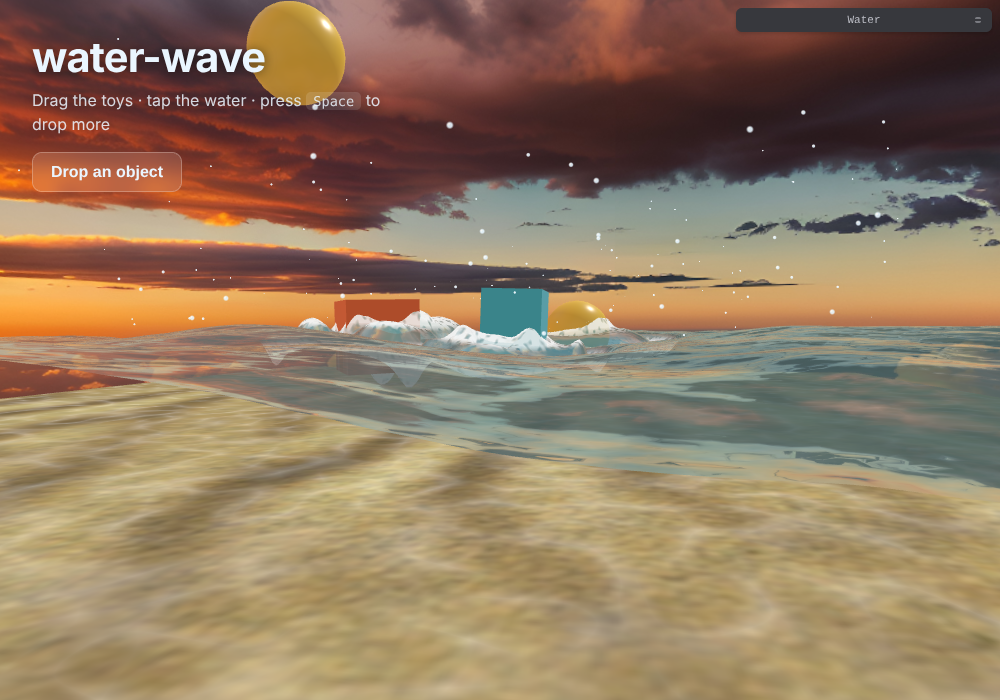

# water-wave

Interactive, stylised water for [three.js](https://threejs.org). Drop objects in
and they **float, bob, tilt, splash and push the water around** — ripples,
bow-waves, foam rings and under-surface caustics, all on the GPU.

It is packaged as a **framework-agnostic module**: the core is plain three.js, so
the same code runs on the **web**, in **mobile apps** (React Native / `expo-gl`),
on **desktop** (Electron / Tauri) and on **TV** (Tizen, webOS, Android TV) —
anywhere WebGL / WebGL2 is available. React and other frameworks are optional
thin wrappers on top.



## Highlights

- 🌊 **Procedural waves** – fractal simplex noise, fully parameterised.
- 💧 **Interactive ripples** – a GPU height-field wave simulation reacts to taps and objects.
- 🧊 **Floating bodies** – real buoyancy for any `Object3D`; they bob, tilt with the waves, drift and collide with the pool walls.
- 💦 **Splashes** – pooled droplet particles that fall back and ripple the surface.
- 🫧 **Foam & shadows** – foam rings where objects pierce the surface, soft shadows and caustics on the floor.
- 🔆 **Caustics everywhere** – the pool floor and the submerged part of floating objects share the same animated caustics.
- 🖱️ **Pointer interaction** – drag/throw objects, tap the water (mouse, touch and pen via Pointer Events).
- 📱 **Scales to the device** – automatic quality presets for phones, desktops and TVs; caps pixel ratio; degrades gracefully with no float-texture support and with **zero assets** (procedural sky + sand fallbacks).
- 🎛️ **Optional tweakpane UI** – lazy-loaded, never in your production bundle unless you ask for it.

> **New to packaging / want to reuse this everywhere?** Read **[GUIDE.md](./GUIDE.md)** —
> it teaches how reusable packages work and walks through installing, the
> background mode, and making *every* value a live variable.

## Install

```bash
npm install three
# from GitHub (no publishing needed — recommended for your own reuse):
npm install github:cosmicdanish1/water-wave-animation
# or, once published to npm under your scope:
npm install @cosmicdanish1/water-wave
```

`three` is a peer dependency. `react` and `tweakpane` are optional (only for
the React hook and the debug UI).

## Quick start (any framework / vanilla)

```js
import { createWaterWorld } from 'water-wave';

const world = createWaterWorld({
  container: document.getElementById('app'), // it creates & manages the canvas
  quality: 'auto',
});

// Drop a cube into the water — it floats and interacts.
world.addCube({ size: 0.12, color: '#ff7a45', position: [0, 0.4, 0] });
world.addSphere({ radius: 0.06, color: '#ffd34d', position: [0.2, 0.5, -0.1] });
```

That's it — the render loop, resizing, reflections, caustics, ripples and
dragging are all handled. Call `world.dispose()` when you're done.

### As an animated UI background (login forms, hero sections)

```js
import { createWaterBackground } from '@cosmicdanish1/water-wave';

const bg = createWaterBackground({ preset: 'twilight', background: false });
// Full-screen water pinned behind your DOM (z-index -1), camera drifting on its
// own, clicks still reaching your form. See examples/login-background.html.
```

### Presets & live configuration — everything is a variable

```js
createWaterWorld({ preset: 'ocean' });   // pool | ocean | calm | tropical | twilight | ink | ambient

world.applyPreset('tropical');           // swap the whole mood any time
world.configure({                        // or set any individual value, live
  water:    { wavesAmplitude: 0.05, surfaceColor: '#36d6c3', fresnelScale: 1 },
  caustics: { causticsIntensity: 0.3, shadowStrength: 0.5 },
  ripples:  { damping: 0.99, strength: 1.5 },
  autoRotate: true,
});
world.setEnvironment('/sky/');           // swap the reflection map at runtime
world.setGroundTexture('/sand.png');
```

Full list of tunables in [GUIDE.md § Part 4](./GUIDE.md#part-4--everything-is-a-variable).

### Dropping your own models in

Anything that is an `Object3D` can float:

```js
import { applyUnderwaterLighting } from 'water-wave';

const boat = await loadMyGLTF();
const body = world.addBody(boat, { density: 0.5, shape: 'box' });

// optional: tint + caustics on the submerged part
boat.traverse((o) => o.material && applyUnderwaterLighting(o.material, world));

body.push(0.3, 0, 0); // give it a shove
```

### React

A tiny hook ships with the demo (`src/useWaterWorld.js`) and is StrictMode-safe:

```jsx
import { useWaterWorld } from 'water-wave/react'; // or copy the hook

function Pool() {
  const { containerRef } = useWaterWorld({ quality: 'auto' }, (world) => {
    world.addCube({ color: '#4dd0e1' });
  });
  return <div ref={containerRef} style={{ width: '100%', height: '100vh' }} />;
}
```

### Mobile / TV

- **React Native / Expo:** pass an `expo-gl` context's renderer (`new THREE.WebGLRenderer({ context })`) as `renderer`, and drive frames from the GL loop with `autoStart: false` + `world.step(dt)` / `world.render()`.
- **TV:** `quality: 'auto'` detects common TV user-agents and drops to the `low` preset. D-pad remotes can call `world.disturb()` / `body.push()` directly.

## Using your own assets (optional)

Everything has a procedural fallback, so assets are optional:

```js
createWaterWorld({
  container,
  environmentMap: { path: '/env/', files: ['px.png','nx.png','py.png','ny.png','pz.png','nz.png'] },
  // or an existing THREE.CubeTexture, or an array of 6 URLs
  groundTexture: '/floor.png', // or a THREE.Texture
});
```

## API sketch

| Call | What it does |
| --- | --- |
| `createWaterWorld(options)` | Build a pool. See options below. |
| `createWaterBackground(options)` | Full-screen water pinned behind your UI. |
| `world.configure(config)` | Change any water/caustics/ripple/camera value, live. |
| `world.applyPreset(name)` | Apply a named look. |
| `world.setEnvironment(src)` / `setGroundTexture(src)` | Swap reflection map / floor at runtime. |
| `world.setCamera({position,target,fov})` / `setAutoRotate(on, speed)` | Aim / drift the camera. |
| `world.addCube/addSphere(opts)` | Add a floating primitive. |
| `world.addBody(object3d, opts)` | Make any object float. Returns a `FloatingBody`. |
| `world.disturb(x, z, radius, strength)` | Ripple the surface. |
| `world.splash(x, y, z, opts)` | Emit droplets. |
| `world.getSurfaceHeight(x, z)` | Exact water height (CPU, matches the shader). |
| `world.on(event, fn)` | `'frame' \| 'grab' \| 'release' \| 'tap'`. |
| `world.step(dt)` / `world.render()` | Manual loop (with `autoStart: false`). |
| `world.dispose()` | Release every GPU resource. |
| `createDebugUI(world)` | Lazy tweakpane panel (returns a Promise). |

Key `createWaterWorld` options: `container` / `canvas` / `renderer`, `preset`,
`quality` (`'auto' \| 'low' \| 'medium' \| 'high'` or an object), `size`,
`depth`, `environmentMap`, `groundTexture`, `background` / `clearColor`,
`placement` (`'inline' \| 'fill' \| 'background'`), `pointerEvents`, `zIndex`,
`camera`, `controls`, `interaction`, `autoRotate`, `water`, `caustics`,
`ripples`, `splashes`, `lights`, `autoStart`.

## How objects interact with the water

The surface is simulated twice, kept in sync:

1. A **CPU mirror** of the exact wave math (`noise.js` ↔ `shaders/noise2d.glsl`)
   so each `FloatingBody` knows the true water height under it for buoyancy and tilt.
2. A **GPU height-field** ripple simulation (`RippleSimulation`): each body stamps
   the change in its submerged footprint into the field every frame, which is what
   produces wakes, bow-waves and the rings when something drops in.

Up to `MAX_BODIES` (8) objects also feed the water & floor shaders for foam rings
and blob shadows; beyond that they still float, just without those extras.

## Develop

```bash
npm install
npm run dev        # demo at http://localhost:5173
npm test           # CPU-noise parity/regression tests
npm run lint
npm run build      # the demo site  -> demo-dist/
npm run build:lib  # the library    -> dist/ (ESM + UMD, three left external)
```

## Credits

Water, caustics and simplex-noise shaders build on the classic three.js water
examples and Ian McEwan / Stefan Gustavson's
[webgl-noise](https://github.com/stegu/webgl-noise). MIT licensed.
